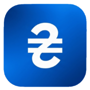
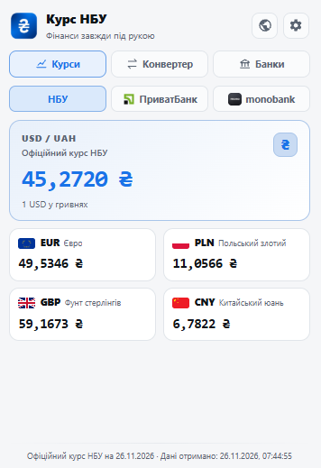
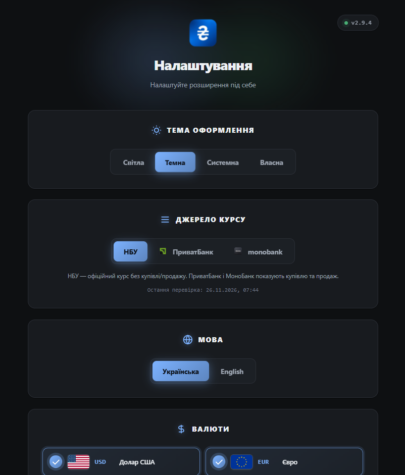
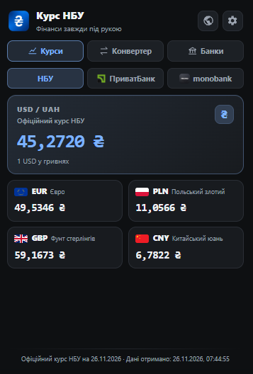
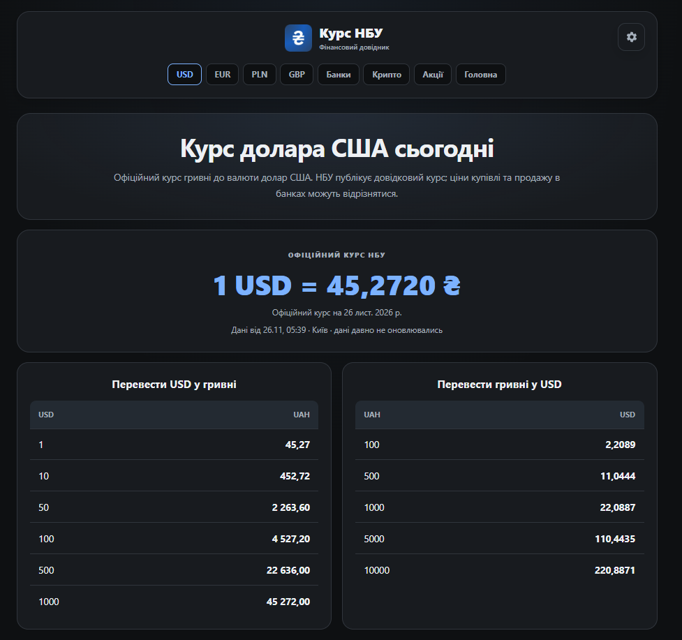
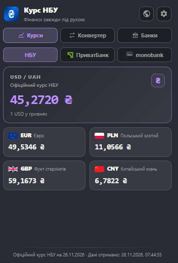
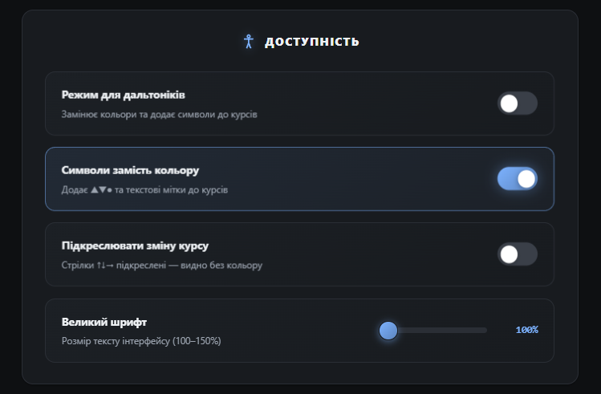

<div align="center">



# Курс НБУ

**Фінанси завжди під рукою.**

Курси валют НБУ та банків, мультивалютний конвертер і порівняння умов обміну — прямо у браузері.

[](https://nbu-rate.info/) [](https://github.com/He-Trogati-Mne/NBU-Rate/releases)

<br>

[](https://addons.mozilla.org/ru/firefox/addon/nbu-rate/)
[](https://microsoftedge.microsoft.com/addons/detail/nbu-rate/hjndboldkmconodmenmccdekhmnnlhbp)
[](https://chromewebstore.google.com/detail/%D0%BA%D1%83%D1%80%D1%81-%D0%BD%D0%B1%D1%83/llhcdbfoebdcmlfiojpjkbejdbopoggo)

<br>

[](#)
[](https://www.gnu.org/licenses/gpl-3.0)
[](#)
[](#)
[](https://github.com/He-Trogati-Mne/NBU-Rate/releases)

<br>

[](https://github.com/He-Trogati-Mne/NBU-Rate)
[](https://github.com/He-Trogati-Mne/NBU-Rate/stargazers)
[](https://github.com/He-Trogati-Mne/NBU-Rate/network/members)

</div>

---

## Що нового у v2.9.4

Велике оновлення порівняно з v2.7.0: від перегляду курсів до повсякденних фінансових розрахунків.

- **Новий інтерфейс** — три вкладки: «Курси», «Конвертер», «Банки».
- **Мультивалютний конвертер** — швидкі суми, обмін напрямку конвертації, копіювання результату та одночасний розрахунок у кількох валютах.
- **Банківський калькулятор** — порівняння купівлі та продажу USD і EUR у ПриватБанку та monobank, окреме відображення комісії та підсумкової суми.
- **Ручна комісія 0–200%** — повзунок, числове поле та швидкі значення.
- **Пошук валют** — за кодом або назвою, з локальними прапорами та іконками дорогоцінних металів.
- **Три дизайни** — сучасний (v2.9), попередній (v2.7) та класичний (v2.6).
- **Оновлення кожні 30 хвилин** — покращене кешування та обробка обмежень API.
- **Візуальні виправлення** — однакові розміри логотипів банків, компактне вікно, приховані смуги прокрутки, усунення зайвого світіння та ліній у старих дизайнах.

[Усі зміни та попередні версії → GitHub Releases](https://github.com/He-Trogati-Mne/NBU-Rate/releases)

---

## Можливості

| Функція | Опис |
|---|---|
| Курси валют | НБУ — офіційні курси; ПриватБанк і monobank — купівля та продаж |
| Конвертер | Розрахунок за курсом НБУ, швидкі суми, копіювання та збереження останніх параметрів |
| Мультивалютний перегляд | Одночасний результат у UAH, USD, EUR, PLN та GBP (крім вихідної валюти) |
| Банківський калькулятор | Порівняння USD/EUR, сума до та після ручної комісії, різниця між свіжими пропозиціями |
| Пошук валют | За кодом або назвою, з прапорами та іконками металів |
| Фонове оновлення | Кожні 30 хвилин; локальний кеш; обробка HTTP 429 |
| Значок розширення | Поточний курс USD з обраного джерела |
| Історія | Індикатори зміни офіційного курсу на основі збереженої історії до 30 днів |

**Валюти.** USD, EUR, GBP, PLN, CNY, CHF, JPY, CAD, AUD, TRY, SEK, NOK, DKK, CZK, HUF, RON, ILS, KRW, SGD, HKD, NZD, MXN, INR, TND, EGP, DZD, AED, SAR, AZN, GEL, KZT, MYR, THB, MDL, ZAR, RSD, XDR та інші доступні в API НБУ. Дорогоцінні метали: золото (XAU), срібло (XAG), платина (XPT), паладій (XPD). Доступність курсів залежить від джерела.

**Оформлення.** Світла, темна, системна та власна теми з HEX-вибором кольорів. Пресети Midnight, Nord, Dracula, Sepia, Forest, Rose. Три варіанти дизайну вікна, вибір валют та точність до чотирьох знаків після коми.

**Доступність.** Чотири палітри для різних типів порушень кольоросприйняття, символи та підкреслення змін курсу, масштаб шрифту 100–150%.

**Локалізація.** Інтерфейс українською та англійською. У збірці є 33 локалізації метаданих (`_locales`); це не означає підтримку 33 мов інтерфейсу.

**Що нового.** Примітки до релізів завантажуються з публічного API GitHub у налаштуваннях.

---

## Встановлення

**Firefox** · [addons.mozilla.org/nbu-rate](https://addons.mozilla.org/ru/firefox/addon/nbu-rate/)

**Edge** · [microsoftedge.microsoft.com/nbu-rate](https://microsoftedge.microsoft.com/addons/detail/nbu-rate/hjndboldkmconodmenmccdekhmnnlhbp)

**Chrome** · [chromewebstore.google.com](https://chromewebstore.google.com/detail/%D0%BA%D1%83%D1%80%D1%81-%D0%BD%D0%B1%D1%83/llhcdbfoebdcmlfiojpjkbejdbopoggo)

<details>
<summary>Встановлення вручну</summary>

<br>

1. Завантажте [останній реліз](https://github.com/He-Trogati-Mne/NBU-Rate/releases) та розпакуйте ZIP-архів
2. Відкрийте `chrome://extensions/` або `edge://extensions/`
3. Увімкніть **Режим розробника**
4. Натисніть **Завантажити розпаковане розширення**
5. Виберіть папку з розширенням, у якій міститься `manifest.json`

</details>

Посилання ведуть на наявні сторінки магазинів. Доступність v2.9.4 залежить від публікації та перевірки в кожному магазині. Для Firefox використовуйте сумісну збірку.

---

## Скріншоти

> Нижче — наявні скріншоти попереднього оформлення. Вигляд v2.9.4 може відрізнятися.

| Світла | Налаштування | Темна |
|:---:|:---:|:---:|
|  |  |  |

| Джерела курсу | Власна тема | Доступність |
|:---:|:---:|:---:|
|  |  |  |

---

## Використання

### Курси

Натисніть на іконку розширення та виберіть джерело: **НБУ / ПриватБанк / monobank**. У налаштуваннях можна вибрати потрібні валюти та точність відображення. Значок на панелі показує курс USD з обраного джерела.

### Конвертер

Відкрийте вкладку **«Конвертер»**, введіть суму та виберіть вихідну й цільову валюту. Результати за курсом НБУ перераховуються автоматично. Доступні швидкі суми, зміна напрямку та копіювання результату.

### Банки

Відкрийте вкладку **«Банки»**, виберіть купівлю або продаж, USD або EUR, введіть суму та за потреби задайте додаткову комісію вручну. Калькулятор покаже базову суму, комісію та підсумок для кожного банку. Вигіднішу пропозицію позначено за наявності двох свіжих курсів.

> Комісія 0–200% — умовний параметр для моделювання, а не фактичний тариф банку. У режимі продажу комісія понад 100% може давати від'ємний результат; розширення показує попередження. Розрахунки мають інформаційний характер.

### Налаштування

Натисніть шестерню у правому верхньому куті. Тут можна змінити мову, тему, акцентний колір, набір валют, точність, параметри доступності та вибрати сучасний, попередній або класичний дизайн. Нові інструменти доступні в усіх трьох дизайнах.

---

## Структура розширення

```text
nbu-rate-extension/
├── manifest.json               Маніфест Manifest V3
├── popup.html / popup.js       Вікно з курсами
├── daily.js / daily.css         Конвертер і банківський калькулятор
├── dashboard.css               Компонування вікна та варіанти дизайну
├── options.html / options.js    Сторінка налаштувань
├── background.js               Фоновий service worker
├── i18n.js                     Переклади, утиліти та джерела курсів
├── theme.css / theme-init.js    Теми та анти-FOUC
├── _locales/                   Локалізації метаданих
├── banks/                      Локальні PNG-логотипи банків
├── flags/                      PNG-прапори
├── svg/                        SVG-іконки, зокрема металів
├── color-fvcn/                 Кольорові іконки
├── settings-logo.png           Логотип налаштувань
└── icon16/32/48/128.png         Іконки розширення
```

Окремий вебсервіс проєкту: [nbu-rate.info](https://nbu-rate.info/).

---

## Технології

**Manifest V3** — сучасний стандарт браузерних розширень

**Service Worker** — замість застарілого background page

**Vanilla JS** — без фреймворків, бандлерів та збірників

**CSS-змінні** — для динамічної теми та анти-FOUC

**chrome.storage.sync** — синхронізація налаштувань між пристроями

**OffscreenCanvas** — генерація іконок на льоту під акцентну тему

**PNG-прапори** — локальні зображення без зовнішніх запитів

**Chart.js** — графіки історії курсів на сайті (окремо від розширення)

**Okabe-Ito** — науково обґрунтована палітра для дальтоніків

---

## Дозволи

| Дозвіл | Навіщо |
|---|---|
| `storage` | Налаштування, параметри калькуляторів, локальний кеш та історія курсів |
| `alarms` | Фонове оновлення курсів кожні 30 хвилин |
| `https://bank.gov.ua/*` | Отримання офіційних курсів НБУ |
| `https://api.privatbank.ua/*` | Отримання публічних курсів ПриватБанку |
| `https://api.monobank.ua/*` | Отримання публічних курсів monobank |
| `https://api.github.com/*` | Отримання публічних приміток до релізів |

Розширення не потребує доступу до історії переглядів або вмісту відвіданих сторінок.

---

## Приватність

Розширення не збирає персональні дані та не використовує аналітику, рекламу чи відстеження користувачів. Налаштування зберігаються через `chrome.storage.sync` та можуть синхронізуватися через акаунт браузера. Кеш курсів, історія й параметри калькуляторів зберігаються через `chrome.storage.local`.

Публічні API, які використовує розширення:

```text
https://bank.gov.ua/NBUStatService/v1/statdirectory/exchange?json
https://api.privatbank.ua/p24api/pubinfo?exchange&json&coursid=11
https://api.monobank.ua/bank/currency
https://api.github.com/repos/He-Trogati-Mne/NBU-Rate/releases
```

Прапори та логотипи зберігаються локально. Зазначені твердження стосуються саме розширення, а не окремого вебсайту чи зовнішніх сервісів, на які ведуть посилання.

Детальніше — [політика конфіденційності](https://nbu-rate.info/#privacy).

---

## Roadmap

**Готово**

- [x] Базовий показ курсів НБУ
- [x] Вибір джерела курсу: НБУ, ПриватБанк, monobank
- [x] Темна, світла, системна тема
- [x] Власна тема з HEX-піпеткою
- [x] Українська та англійська мови
- [x] Прапори країн (PNG)
- [x] Значок на іконці з курсом USD
- [x] Режим для дальтоніків (4 палітри)
- [x] Символи та великий шрифт
- [x] Три дизайни: v2.9, v2.7, v2.6
- [x] Мультивалютний конвертер
- [x] Банківський калькулятор з ручною комісією
- [x] Пошук валют і дорогоцінних металів
- [x] Оновлення курсів кожні 30 хвилин
- [x] Примітки до релізів у налаштуваннях
- [x] Анти-FOUC при перезавантаженні
- [x] Аналітика курсу з графіками
- [x] Публікація в Firefox Add-ons
- [x] Підтримка Firefox для Android (попередні сумісні збірки)
- [x] Публікація в Edge Add-ons
- [x] Публікація в Chrome Web Store

**У планах**

- [ ] Публікація в Opera Add-ons
- [ ] Сповіщення при різкій зміні курсу
- [ ] Експорт та імпорт налаштувань у JSON
- [ ] Нові мови інтерфейсу

---

## Як долучитися

1. Форкніть репозиторій
2. Створіть гілку: `git checkout -b feature/amazing-feature`
3. Закомітьте: `git commit -m 'Add: amazing feature'`
4. Запуште: `git push origin feature/amazing-feature`
5. Відкрийте Pull Request

Знайшли баг — [створіть Issue](https://github.com/He-Trogati-Mne/NBU-Rate/issues).

---

## Ліцензія

Проєкт розповсюджується під **GNU General Public License v3.0**.

Повний текст — у файлі [LICENSE](LICENSE).

Під час розповсюдження змінених або похідних версій дотримуйтеся умов GPL-3.0, зокрема щодо надання відповідного вихідного коду.

---

<div align="center">

**Це неофіційне розширення.** Не пов’язане з Національним банком України, ПриватБанком або monobank.

Дані надаються публічними API НБУ, ПриватБанку та monobankу.

<br>

[nbu-rate.info](https://nbu-rate.info/)

**Зроблено в Україні 🇺🇦**

</div>


</div>
